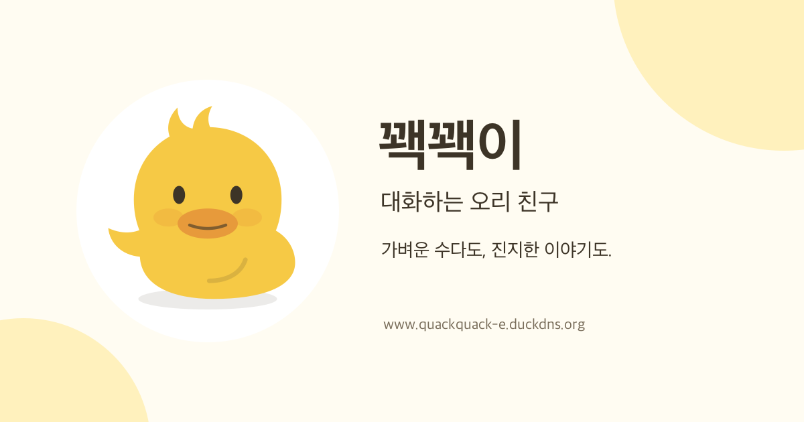
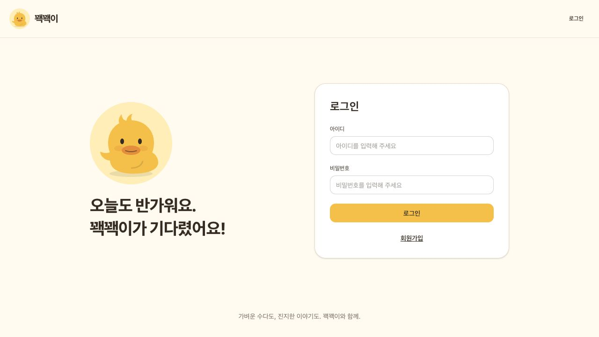
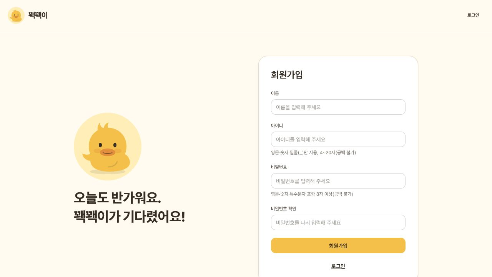
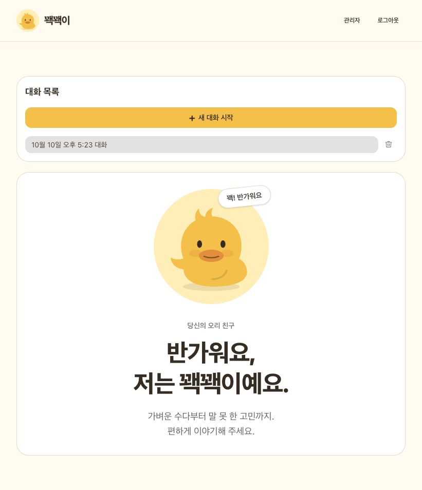
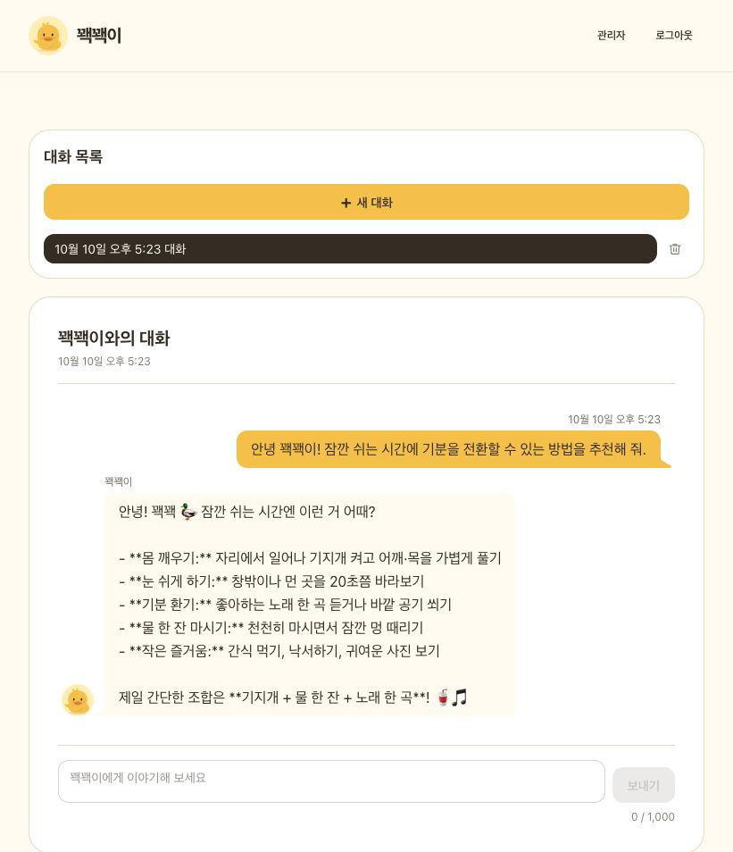
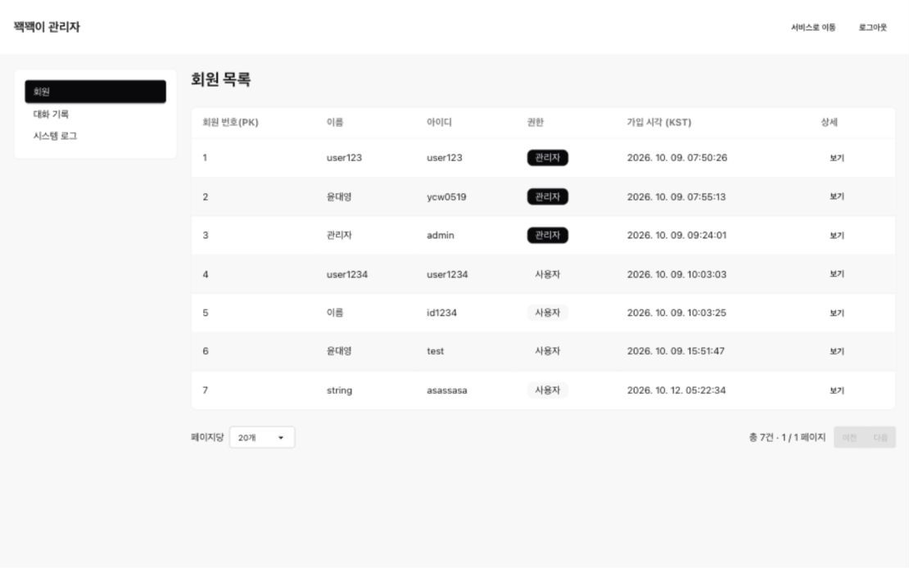
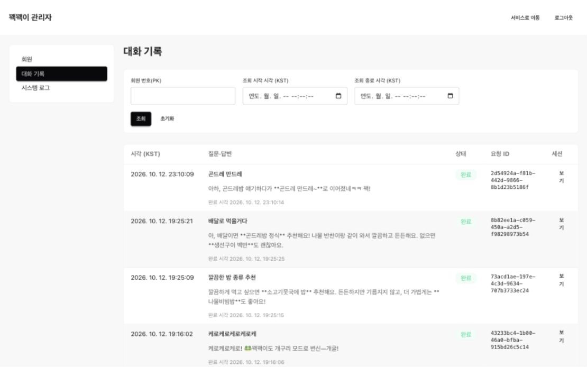
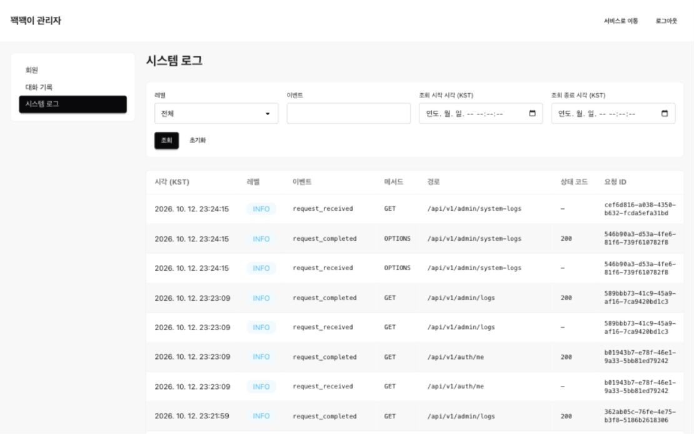

# 꽥꽥이

**가벼운 수다도, 진지한 이야기도. 대화하는 오리 친구 꽥꽥이.**

[서비스 이용하기](https://www.quackquack-e.duckdns.org/)

## 목차

- [서비스 소개](#서비스-소개)
- [주요 기능](#주요-기능)
- [서비스 특징](#서비스-특징)
- [서비스 화면](#서비스-화면)
- [기술 스택](#기술-스택)
- [관련 문서](#관련-문서)

## 서비스 소개

꽥꽥이는 궁금한 것을 물어보거나 하루의 이야기를 나누고 싶은 사용자를 위한 AI 챗봇 서비스입니다.

주제별 대화와 저장된 질문·답변으로 이야기를 이어 갑니다.

**회원가입 → 로그인 → 새 대화 시작 → 질문과 답변 → 이전 대화 다시 보기**

## 주요 기능

| 기능            | 설명                                                 |
| --------------- | ---------------------------------------------------- |
| 회원가입·로그인 | 회원가입·로그인 후 본인의 대화 이용                  |
| AI 대화         | 질문·답변과 같은 대화의 문맥 유지                    |
| 대화 목록       | 주제별 대화 생성·전환                                |
| 기록 조회·삭제  | 저장된 질문·답변 조회 및 대화 삭제                   |
| 회원 관리       | 관리자의 회원 정보·대화 조회 및 권한 변경            |
| 로그 조회       | 관리자의 회원·기간별 대화 기록 및 시스템 이벤트 조회 |

## 서비스 특징

### 대화하는 오리 친구

노란색과 오리 캐릭터로 친근한 대화 화면을 구성했습니다.

### 이야기를 나누고 다시 찾기

저장된 대화를 다시 열어 이전 질문과 답변을 참고하며 이야기를 이어 갑니다.

### 대화에 맞춘 입력과 화면

최대 1,000자 입력과 자동으로 늘어나는 입력창, 반응형 화면, 답변 대기·재시도 안내를 제공합니다.

## 서비스 화면

### 회원가입·로그인

로그인하면 일반 회원은 대화 홈, 관리자는 회원 관리 화면으로 이동합니다.

#### 로그인

#### 회원가입

### 대화 홈·대화창

새 대화를 시작하거나 이전 대화를 선택해 질문과 답변을 주고받습니다.

#### 대화 홈

#### 질문과 답변

### 관리자 화면

회원 정보·권한 관리와 대화 기록·시스템 이벤트 조회를 제공합니다.

#### 회원 관리

#### 대화 기록

#### 시스템 로그

## 기술 스택

| 영역             | 기술                                          |
| ---------------- | --------------------------------------------- |
| 프론트엔드       | React, TypeScript, Vite                       |
| 스타일           | Tailwind CSS 4, daisyUI 5                     |
| 라우팅·상태 관리 | React Router, useState, Context               |
| API 요청         | fetch                                         |
| 테스트·모킹      | Vitest, React Testing Library, MSW            |
| 코드 검사·정리   | ESLint, Prettier, prettier-plugin-tailwindcss |
| 배포             | Vercel                                        |

## 관련 문서

- [프론트엔드 개발 안내](./docs/DEVELOPMENT.md)
- [백엔드 레포지토리](https://github.com/myy-dev/be-B7-1)
